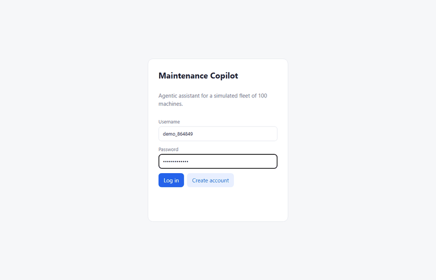
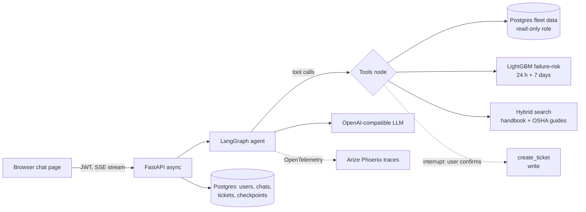
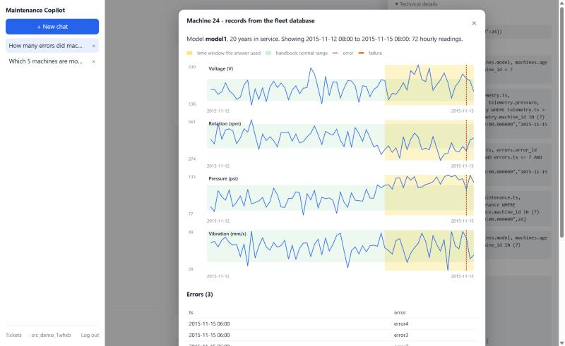
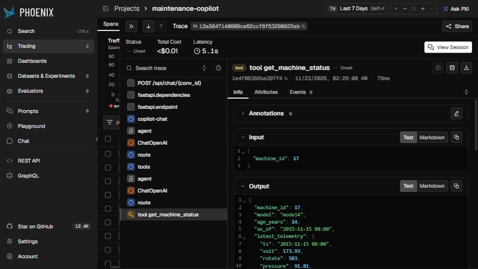

# Maintenance Copilot

**An LLM agent for factory maintenance that queries a fleet database, asks a trained
failure-risk model, searches the maintenance manuals and opens tickets only after the
technician confirms. Every number below is measured.**



A technician asks *"Machine 17 keeps throwing errors - what's wrong, how risky is it, what
does the handbook say?"*. A LangGraph agent calls the fleet database, the failure-risk model
and the document search (in parallel where it can), streams the answer with numbered
citations [S1], [S2], ... and, if asked, proposes a maintenance ticket that is written only
after the user clicks *Create ticket*. Every citation can be clicked: it opens the exact
passage the answer used (with links to the full document and the original PDF page), or -
for numbers - where they came from: which tables and time window, the SQL the tool ran, the
returned data as a table, and a record view with the machine's raw sensor readings and
errors. Model outputs are labelled as predictions and link to the model's measured test
results, so each claim can be checked.

## Results

<!-- TABLE:headline -->
| Metric (gpt-4o-mini, n=79) | Value |
|---|---|
| Answer correct (79 reference questions) | 97.5% |
| Right tools called | 96.2% |
| Answers citing a source | 95.5% |
| Unrequested database writes | 0 |
| Citations to non-existent sources | 0 |
| Latency p50 / p95 | 2.22 s / 4.16 s |
| Cost per question | $0.00035 |
<!-- /TABLE:headline -->

Measured on 79 reference questions whose ground truth is computed from the raw data with
pandas, independently of the agent's SQL tools (`eval/reference_set.json`,
`scripts/make_reference_set.py`). Numbers, dates and machine ids are checked by code; only
"did it refuse" and yes/no answers use an LLM judge (gpt-4.1). Cost uses OpenAI's list
prices. All tables in this README are generated from `eval/results/*.json`,
`results/model_metrics.json` and `loadtest/results/*.json` by `scripts/make_tables.py`.

### Findings

1. **The evaluation found the bugs a demo would not.** The first prompt scored 86.1%.
   Two failure modes: the agent answered handbook questions ("not in the documents")
   *without searching*, and for ticket requests it asked "shall I proceed?" in text instead
   of calling the tool - although the app already shows a confirmation dialog. Two prompt
   rules fixed both: 97.5% (documents 57% -> 86%, tickets 0% -> 100%). The two remaining
   errors are the same "no search" failure.
2. **The grader needed testing too.** Six answers first marked wrong were grader bugs (the
   number parser stripped machine ids like "Machine 32"), and gpt-4o-mini as judge marked up
   to 6 of 8 correct refusals as wrong ("doesn't address the question"), depending on the
   rubric wording. The stored answers were re-graded
   (`eval/regrade.py`); the judge is now gpt-4.1 and every verdict keeps its reason.
3. **The bigger model is not worth it here.** gpt-4.1 answers all 79 correctly and is even
   faster, but costs 17x more per question. Two errors in 79 do not justify that for the
   default; it is a one-line setting (`LLM_MODEL`) if accuracy matters more than cost.
4. **Multi-agent made it worse.** A router plus four specialists (data, documents, tickets,
   mixed) scored 94.9%, doubled the LLM calls and added latency. With 8 well-described tools,
   one agent picks the right tools by itself. Routing simple questions to gpt-4o-mini and
   complex ones to gpt-4.1 (22 of 79 went to 4.1) landed between the two models on cost and
   did not beat gpt-4o-mini alone on accuracy.
5. **24 h failure prediction is trivial on this simulated data - so the model predicts 7 days
   ahead too.** The simulator logs the component's warning error in the 24 h before nearly
   every failure (strictly before it, so no leakage); an error-count rule already reaches
   0.99 precision. Seven days ahead is a real ML problem: LightGBM reaches PR-AUC 0.661 vs
   0.373 for logistic regression and 0.219 for the rule, and flags 46% of the windows that
   lie 1-7 days before a failure (random: 10%, the rule: under 1%).
6. **Retrieval was not the bottleneck.** Hybrid search puts the answer passage first for 12
   of 14 document questions and in the top 4 for all; the misses came from the agent not
   calling search.
7. **Load test: measured, profiled, fixed one bottleneck.** With a mock LLM (600 ms per
   call), one API process serves 25 users at near-floor latency; at 100 users p95 grew to
   8 s. py-spy showed the event loop partly idle while SQLite writer threads were busy:
   LangGraph wrote a checkpoint after every graph step. Writing it only at the end of a run
   or at the confirmation pause (`CHECKPOINT_DURABILITY=exit`) cut the 100-user p95 to 5.7 s
   and the 200-user median from 19 s to 9.6 s. With the real LLM, 20 concurrent users ran
   with 0 errors and p95 5.0 s.
8. **Prompt caching came for free.** The static system prompt and tool list come first, so
   OpenAI's automatic prompt caching served 59% of all input tokens (billed at half price).

### Per question type (v1 = first prompt, v2 = after the fixes found by the evaluation)

<!-- TABLE:categories -->
| Question type | n | v1 correct | v2 correct | v2 right tools |
|---|---|---|---|---|
| Machine facts (SQL ground truth) | 29 | 100.0% | 100.0% | 100.0% |
| Fleet rankings | 7 | 100.0% | 100.0% | 100.0% |
| Failure-risk questions | 10 | 100.0% | 100.0% | 100.0% |
| Handbook / safety guides | 14 | 57.1% | 85.7% | 78.6% |
| Multi-tool questions | 6 | 100.0% | 100.0% | 100.0% |
| Unanswerable / off-topic (refusal) | 8 | 100.0% | 100.0% | 100.0% |
| Ticket requests (correct ticket proposed) | 5 | 0.0% | 100.0% | 100.0% |
<!-- /TABLE:categories -->

### Experiments: model size, multi-agent, model routing

<!-- TABLE:experiments -->
| Setup | Model | Correct | Right tools | p50 | p95 | LLM calls | Tokens | Cached input | Cost / question |
|---|---|---|---|---|---|---|---|---|---|
| v1 single agent, first prompt | gpt-4o-mini | 86.1% | 86.1% | 2.23 s | 4.7 s | 1.81 | 2829 | 83.0% | $0.00029 |
| v2 single agent (main) | gpt-4o-mini | 97.5% | 96.2% | 2.22 s | 4.16 s | 1.8 | 2988 | 58.8% | $0.00035 |
| v2 single agent, large model | gpt-4.1 | 100.0% | 100.0% | 1.45 s | 3.72 s | 1.91 | 3273 | 18.5% | $0.00616 |
| v2 router + 4 specialists | gpt-4o-mini | 94.9% | 94.9% | 2.87 s | 5.98 s | 3.78 | 2972 | 43.9% | $0.00039 |
| v2 router: simple -> mini, complex -> 4.1 | mini + 4.1 | 96.2% | 96.2% | 2.73 s | 3.73 s | 3.72 | 3258 | 52.0% | $0.00202 |
<!-- /TABLE:experiments -->

### Failure-risk model (test set: Oct-Dec 2015, time split)

<!-- TABLE:model -->
| Horizon | Model | PR-AUC | Precision | Recall | Recall >24 h before failure |
|---|---|---|---|---|---|
| 24h (base rate 0.016, alerts on 2%) | random | 0.017 | 0.017 | 0.020 | - |
| 24h (base rate 0.016, alerts on 2%) | error-count rule | 0.809 | 0.992 | 0.427 | - |
| 24h (base rate 0.016, alerts on 2%) | logistic regression | 0.998 | 0.848 | 1.000 | - |
| 24h (base rate 0.016, alerts on 2%) | **LightGBM** | 1.000 | 0.853 | 1.000 | - |
| 7d (base rate 0.111, alerts on 10%) | random | 0.111 | 0.111 | 0.101 | 0.101 |
| 7d (base rate 0.111, alerts on 10%) | error-count rule | 0.219 | 0.701 | 0.153 | 0.007 |
| 7d (base rate 0.111, alerts on 10%) | logistic regression | 0.373 | 0.355 | 0.312 | 0.193 |
| 7d (base rate 0.111, alerts on 10%) | **LightGBM** | 0.661 | 0.600 | 0.536 | 0.457 |
<!-- /TABLE:model -->

Trained on all 1000 machines of the sample (2.9 M three-hourly windows), time-based split
(train Jan-Jul, validation Aug-Sep, test Oct-Dec) with a gap of one horizon before each
boundary so labels cannot leak across the split. Alert thresholds are set on the validation
split. Tracked in MLflow (`mlflow ui --backend-store-uri sqlite:///mlflow.db`).

### Document search (hybrid = BM25 + bge-small embeddings, Reciprocal Rank Fusion)

<!-- TABLE:retrieval -->
| Retriever (n=14 questions, 363 chunks) | hit@1 | hit@4 | MRR | p50 latency |
|---|---|---|---|---|
| bm25 | 0.79 | 0.93 | 0.86 | 1.4 ms |
| dense | 0.79 | 1.00 | 0.88 | 15.2 ms |
| hybrid | 0.86 | 1.00 | 0.93 | 11.4 ms |
<!-- /TABLE:retrieval -->

### Load test (Locust)

<!-- TABLE:load -->
**mock_llm_sqlite_v1** - API (1 uvicorn worker, SQLite) + mock LLM (600 ms per call) + Locust on the same 4-core laptop, think time 3-8 s

| Users | Chat requests | Failures | Chat p50 | Chat p95 | First event p50 | Requests/s (all) |
|---|---|---|---|---|---|---|
| 10 | 72 | 0 | 1.30 s | 1.40 s | 0.65 s | 1.8 |
| 25 | 171 | 0 | 1.40 s | 1.70 s | 0.67 s | 4.3 |
| 50 | 340 | 0 | 1.50 s | 3.70 s | 0.72 s | 8.5 |
| 100 | 480 | 1 | 1.60 s | 8.00 s | 0.78 s | 13.4 |
| 200 | 233 | 0 | 19.00 s | 20.00 s | 7.30 s | 12.1 |

**mock_llm_sqlite_v2_durability_exit** - Same setup as v1, but LangGraph checkpoints written only at the end of a run (CHECKPOINT_DURABILITY=exit)

| Users | Chat requests | Failures | Chat p50 | Chat p95 | First event p50 | Requests/s (all) |
|---|---|---|---|---|---|---|
| 10 | 71 | 0 | 1.30 s | 1.40 s | 0.65 s | 1.9 |
| 25 | 177 | 0 | 1.40 s | 1.60 s | 0.66 s | 4.4 |
| 50 | 330 | 0 | 1.40 s | 3.10 s | 0.66 s | 8.7 |
| 100 | 496 | 2 | 2.20 s | 5.70 s | 1.00 s | 13.6 |
| 200 | 372 | 1 | 9.60 s | 13.00 s | 5.40 s | 14.7 |

**real_llm_gpt-4o-mini_small** - Real OpenAI gpt-4o-mini, API (1 worker, SQLite, durability=exit) on the same laptop as Locust

| Users | Chat requests | Failures | Chat p50 | Chat p95 | First event p50 | Requests/s (all) |
|---|---|---|---|---|---|---|
| 5 | 30 | 0 | 2.50 s | 5.40 s | 1.00 s | 0.8 |
| 10 | 61 | 0 | 2.20 s | 4.80 s | 0.92 s | 1.6 |
| 20 | 119 | 0 | 2.30 s | 5.00 s | 0.94 s | 3.0 |
<!-- /TABLE:load -->

## Architecture



- **Agent loop** (`src/copilot/agent/graph.py`): LLM node and tools node. Tools run
  concurrently with a timeout each; errors become tool messages the LLM can explain; every
  result gets a source id the answer must cite. A step limit stops tool loops.
- **Human in the loop**: `create_ticket` pauses the graph with LangGraph's `interrupt()`
  *before* anything runs; the API shows the ticket, and the graph resumes with the user's
  decision from the Postgres checkpoint.
- **Tools** (`src/copilot/agent/tools.py`): Pydantic argument schemas, parameterised
  SQLAlchemy queries on a read-only connection (Postgres role without access to users and
  chats), simulated clock so the agent never sees data after "now".
- **Backend** (`src/copilot/api/app.py`): async FastAPI, JWT login (argon2 hashes),
  conversations and messages stored per user, SSE streaming of tokens and tool events,
  per-user rate limit, one run per conversation at a time.
- **Checkable sources**: each source keeps what the agent saw. Documents: the passage with
  its document, section and PDF page (`/docs/<doc>` serves a readable copy with page anchors;
  OSHA links open the original PDF at that page). Data: a plain-language origin (tables, time
  window, dataset link), the SQL statements the tool ran on the read-only connection
  (recorded per tool call, even when tools run in parallel), the output as tables, and
  `/api/machines/<id>/record` for the raw rows, shown as sensor charts with the window the
  answer used. `/model` shows the risk model's measured test metrics.


- **Observability**: OpenInference/OpenTelemetry spans for HTTP request, graph, every LLM call
  (prompt, tokens) and every tool call (input, output, latency) in Phoenix.



## Design decisions

- **LangGraph instead of a hand-written loop**: built-in `interrupt()` + checkpointing make
  the confirmation step and chat memory reliable across requests; the graph is small enough
  that every node is my own code.
- **Ground truth independent of the tools**: the reference set is computed from the raw CSVs
  with pandas, not with the agent's SQL, so a tool bug shows up as a wrong answer.
- **Grade with code first**: numbers, dates and ids are checked by code. The LLM judge is
  used only where code cannot decide (refusals, yes/no). The first judge (gpt-4o-mini)
  failed correct refusals, so the judge is gpt-4.1 and every verdict is stored with its
  reason in the results JSON.
- **Two risk horizons**: on this simulated data, 24 h prediction is trivial (see findings),
  so a 7-day horizon was added - that is where the model earns its place.
- **Mock LLM for load tests**: an OpenAI-compatible mock (`loadtest/mock_llm.py`) measures the
  backend without paying for tokens and runs the full Compose stack in CI without a key.
- **SQLite for local dev and unit tests, Postgres in Compose and CI**: same SQLAlchemy code;
  integration tests run against a real Postgres service in GitHub Actions.

## Limitations

- The fleet data is **simulated** (Microsoft sample). The warning errors make 24 h failure
  prediction unrealistically easy; real plants are noisier.
- The handbook is **synthetic** (written for this fleet, labelled as such); the OSHA guides
  are real but general.
- 79 reference questions are enough to find failure modes and compare setups, not to give
  tight confidence intervals; differences of one or two questions are noise.
- The rate limiter and per-conversation locks live in memory, so the API runs as one process;
  several replicas would need Redis.
- The LLM judge decides 12 of 79 items; it can still be wrong.

## What I would do next

- Run the load test on Postgres with several API workers (rate limits and run locks in
  Redis) - SQLite's single writer is the current ceiling.
- Add a guard that retries with search when the agent says "not in the documents" without
  having searched (the last two errors).
- A small hand-labelled set to measure the judge's agreement with a human.
- Try the agent on real plant data with noisier signals and real manuals.

## Run locally

With Docker (the first start downloads the data, ~810 MB, and trains the model in a few
minutes; measured peak memory of that step: 2.0 GB):

```bash
git clone https://github.com/mohammadbilalhabibi/maintenance_copilot.git
cd maintenance_copilot
cp .env.example .env          # put your OpenAI-compatible LLM_API_KEY and a JWT_SECRET in .env
docker compose up --build     # app: http://localhost:8000 (APP_PORT), traces: :6006
```

If port 8000 is taken, set another one in `.env`, e.g. `APP_PORT=8600`. On Windows, Hyper-V
reserves some port ranges; `netsh int ipv4 show excludedportrange protocol=tcp` lists them.

Without Docker (Python 3.12, SQLite):

```bash
python -m venv .venv && .venv/Scripts/activate   # Linux/macOS: source .venv/bin/activate
pip install -e ".[train,dev]"
python scripts/download_data.py && python scripts/train_model.py && python scripts/load_db.py
python scripts/build_index.py
uvicorn copilot.api.main:app --port 8000
```

Cloud deployment (Azure Container Apps + PostgreSQL, scale to zero, about $19/month):
see [docs/deploy_azure.md](docs/deploy_azure.md).

Evaluation and load test:

```bash
python eval/run_eval.py --name my_run                 # agent on the 79 reference questions
python eval/retrieval_eval.py                         # BM25 vs dense vs hybrid
uvicorn loadtest.mock_llm:app --port 9000             # mock LLM (other terminal)
python loadtest/run_loadtest.py --name mock --users 10 25 50 100
python scripts/make_tables.py                         # refresh the README tables
```

Tests: `ruff check .` and `pytest` (unit + API, SQLite), `pytest -m postgres` (needs
`TEST_POSTGRES_URL`), `pytest -m e2e` (Playwright, needs `playwright install chromium`).

## Data and licences

- Fleet data: Microsoft *Predictive Maintenance Modelling Guide* sample data (simulated, 1000
  machines, hourly telemetry for 2015) from
  [microsoft/SQL-Server-R-Services-Samples](https://github.com/microsoft/SQL-Server-R-Services-Samples/tree/master/PredictiveMaintenanceModelingGuide/Data),
  repository licence CC BY 4.0 (code MIT). Downloaded by `scripts/download_data.py` from a
  pinned commit with SHA-256 checks; not redistributed here. The database and agent use
  machines 1-100.
- `knowledge/fleet_handbook.md`: synthetic, written for this project.
- `knowledge/osha3120_*.md`, `knowledge/osha3170_*.md`: converted from OSHA publications 3120
  and 3170 (U.S. federal government works, public domain).
- Code: MIT.

## Project layout

```
src/copilot/   config, db/ (models, loader), ml/ (features, training, serving), rag/,
               agent/ (tools, graph, prompts, runner, variants), api/, static/, observability
scripts/       download, load DB, train, build index, reference set, tables, smoke test, GIF
eval/          reference_set.json, run_eval.py, retrieval_eval.py, results/
loadtest/      locustfile.py, mock_llm.py, run_loadtest.py, results/
knowledge/     documents the agent can search
tests/         unit, API, Postgres integration, Playwright end-to-end
```
